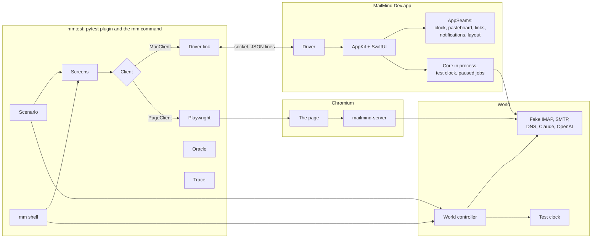
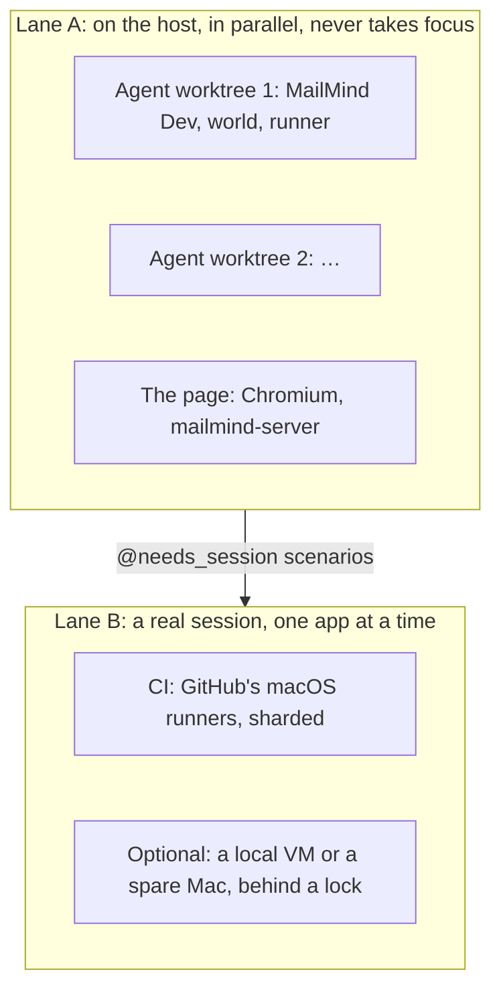

# The end-to-end test framework

[test-strategy.md](test-strategy.md) says what to test and at which ring. This document is the framework that runs
the whole-app rings (R3 to R5): its parts, how they connect, how it keeps time and knows when the app is quiet, how it
stays away from a person's data, and what a test looks like. Lower rings keep the tools they have (`cargo test`,
pytest's unit and served suites, XCTest, Vitest).

It is written for the people who will use it most: coding agents working in parallel worktrees on a Mac someone is
using, and the owner. So it puts three things first. The framework is safe by construction, not by a brief. It can be
driven by hand, a command at a time, as well as by tests. And it answers in text first.

## 1. The shape



| Part | What it is | Where |
| --- | --- | --- |
| `mmtest` | The framework: the world, the clients, the screens, settling, the oracle and the trace, as a pytest plugin | `tests/framework/mmtest/` |
| `mm` | The same framework as a command, for driving a live app by hand (section 3) | `tests/framework/mm`, `just mm` |
| Scenarios | The tests, by feature | `tests/scenarios/<feature>/test_*.py` |
| World controller | The fake servers, the corpus, delivery, faults and the test clock | `tests/framework/mmtest/world.py`, over `tests/fakes/` |
| MailMind Dev | The Debug build of the Mac app, with its own identity and the driver compiled in (section 6) | `shells/apple`, Debug configuration |
| Driver | Carries out the runner's commands inside the app | `shells/apple/Sources/Dev/Driver/` |
| `AppSeams` | Every way the Mac app reaches the system, behind one seam, as the core's `Seams` does | `shells/apple/Sources/Seams/` |
| `MailMindTestKit` | Real input (keys under a layout, mouse, menus), lookup and settling in Swift, shared by the driver and the XCTest targets | `shells/apple/TestKit/` |
| Page client | Playwright on the real build, served by `mailmind-server` | `tests/framework/mmtest/page.py` |

## 2. A test

```python
from mmtest import clients, mail

@clients("mac", "page")
def test_words_typed_in_a_reply_all_go_above_the_signature(world, app):
    world.account("ada").signature = "Ada at the Guild"
    note = world.deliver(mail.from_("lin").to(6).cc(4).subject("Venue"))

    app.inbox.show_tab("Everything")                # the Inbox opens on what needs you
    app.inbox.row(subject="Venue").open()
    composer = app.reader.reply_all()
    composer.type("Got it, thanks.")
    assert composer.send_button.visible
    composer.send()
    assert composer.asks[0].startswith("Not sent yet · This reply goes to 10 people.")
    composer.send_anyway()
    world.clock.advance(seconds=11)                 # Undo Send's window is a long delay: only the test moves past it

    sent = world.smtp.wait_for_one()
    assert sent.text.startswith("Got it, thanks.\n\n-- \nAda at the Guild")
    assert sent.recipients == note.reply_all_recipients(me="ada")
```

That is `tests/scenarios/compose/test_reply.py` as it runs on the page. Written first without the app at hand, it
missed two rules the app holds: a reply all to five people or more asks before it goes, and a send waits out its Undo
window.

Around each line the framework:

1. Turns the action into real input through the client (section 5).
2. Settles: waits until the app, the core and the world are quiet, moving the test clock through short delays (section 7).
3. Runs the oracle, which fails the test at the step that broke an invariant (section 8).
4. Adds a step to the trace, written out only when the test fails (section 9).

`@clients("mac", "page")` runs the test on both. Only a scenario that holds a rule both clients share runs on both;
where the two are meant to differ (own windows, menus, the page's tabs), each client has its own scenarios.

**Why plain Python, not Gherkin.** pytest-bdd would put feature files and step patterns between the test and the
screens. A failure would then point into a step function matched by a pattern, and agents would hunt for the pattern
before the bug. It would also give up the loops, helpers and Hypothesis the scenarios need. The readability Gherkin
promises comes another way: each test is named as a sentence, each screen method carries the phrase a person would use,
and `just e2e catalogue` writes the readable list from what actually ran (section 9), so it never goes stale.

## 3. `mm`: driving a live app by hand

The review found its bugs by exploring the app, a command at a time, through a probe it had to build itself. The
framework gives that to everyone, with the same verbs the tests use:

```
$ just mm up mac --world daily          # a world, MailMind Dev on it, and a prompt
mm> shown                               # what's on screen, as text
window "Inbox — All accounts" (key)
  rail: [Inbox 9] [Needs you 4] [Waiting 2] …
  list.tab: Needs you* · Everything · Unread
  list: 4 rows, chosen 1
    > Lin Mori — Venue · 2m ago · needs you
      Pell Bank — Your statement · 1h ago
  reader: "Venue" from Lin Mori, 3 in thread
  keyboard: list
mm> press e
mm> shown --diff                        # only what changed
mm> deliver long --from noor
mm> clock +7h
mm> truth digest
mm> picture                             # a PNG path
mm> save-step "archive the first row"   # appends the step to a draft scenario
```

- `mm up mac|page` starts a world and a client and leaves them running; `mm down` stops them. `mm attach` reconnects.
- Every test takes `--keep`: when it fails, it leaves the world and the app up and prints the `mm attach` line.
- Every failure prints a one-line repro: `just e2e tests/scenarios/compose/test_reply.py::test_words_… --client mac`.
- `mm` replaces the review's file-polled probe and its control scripts. Review passes and scenarios use one driver.

**As built (step 1, the page).** `just mm up page` starts a session in a process of its own (the world, Chromium and
the page) and opens the prompt; `--detach` leaves out the prompt, as a script or an agent wants, and `--headed` shows
Chromium. Every verb also runs alone, `just mm shown`, `just mm press e`, which is how an agent drives it. The session
is the worktree's: its Unix socket and its record are in the system's temp folder, named from the worktree's path. The
verbs are `shown [--diff]`, `press`, `type`, `click` and `find` (role, label, `in` a region, `subject=`),
`open`, `deliver` (`--from`, `--to`, `--folder`, `--cc N`, `--long`), `judge`, `clock`, `run`, `first-run`,
`restart`, `where`, `sent`, `events`, `settle`, `picture` and `save-step`, which appends what was done since the last
save to `build/mm/draft_scenario.py` as scenario lines. `truth` waits for the oracle. On the tiny world, `mm up page`
then `mm shown` says:

```
page "MailMind" /p/5tLAA6gX1uhMHC4kHcq-Yg
  rail: Ada · [Inbox 10]* [Sent] [Drafts] [Archive] [Junk] [Trash] [Unread] [Flagged] [Has attachments] [Last 7 days] [Feed] [Paper trail] [Notifications] [Action needed] [Finance] [Documents] [Screener 6] [Snoozed]
  list "Inbox": Needs you* 0 · Everything 11 · Unread 10
  list: 0 rows
    (Nothing needs you. Everything else is in Everything.)
  reader: brief: Good afternoon. · Needs you · Nothing needs you right now.
  keyboard: nowhere (the page itself)
```

## 4. The world

```python
class World:
    accounts: dict[str, Account]      # ada (IMAP), bea (Proton Bridge), cy (Gmail)
    imap: FakeIMAP; smtp: FakeSMTP; dns: FakeDNS; ai: FakeAI
    clock: TestClock

    def deliver(self, message, to="ada", folder="INBOX") -> Delivered
    def corpus(self, name)            # tiny | daily | large, or a named shape
    def fault(self, script)           # imap.down(), imap.drop_after("UID MOVE"), smtp.refuse(), ai.slow(12)…
    def restart_app(self, zone=None)  # the same home, a new process; a new time zone is a restart, never a system change
```

- **A world is a home.** A run's data directory, its keychain stand-in, its database key and its preferences live in
  one temp folder. A named corpus is built once per build and copied, so a scenario starts in a second, not after a
  sync.
- **Faults are scripts:** what fails, when, how, for how long on the test clock. Deterministic scenarios script them;
  chaos runs draw them at random from the same list.
- **The page's server is `mailmind-server`.** The Mac app runs only the Rust core, and the Python server is retired
  after the flip, so scenarios don't run twice for two servers. The served suites (`tests/api` and the ledger) keep the
  Python server honest until it goes.

**As built (step 1).** The world is `World` in `tests/framework/mmtest/world.py`, over `tests/fakes` and
`tests/support/served.py`, which starts `mm-served`. Its corpus is `tiny`, the suites' world (`fixtures/world.py`):
its database is built once a pytest session (or once an `mm` session) by the app's own ingest
(`world.build_template`) and copied into each home. It has `deliver(message, to, folder)`, which syncs the folder as
the background sync would, `judge(delivered, importance, …)` in place of the AI's triage, `run(job, …)`,
`restart_app()`, `first_run()`, `account(name).signature`, `where(subject)` and `smtp.wait_for_one()`. A change the
app only reads as it starts (the config, a verdict) is made with the server stopped, and each client opens its page
again. `fault` and the larger corpora are still to come; the fakes' own knobs (`world.imap`, `world.smtp.fake`) serve
meanwhile.

## 5. The clients

Both clients implement one interface. Screens call only this interface.

```python
class Client(Protocol):
    def press(self, keys: str, layout: str = "us") -> None   # "e", "cmd+shift+f", "pagedown"
    def type(self, text: str) -> None
    def click(self, target: Element, count: int = 1) -> None
    def drag(self, source: Element, onto: Element) -> None
    def choose_menu(self, *path: str) -> None
    def find(self, role: str, label: str | None = None, within: str | None = None, **where) -> Element
    def shown(self) -> Shown          # what a person sees (section 8)
    def truth(self) -> Truth          # what the core holds (section 8)
    def picture(self) -> Path
    def settle(self) -> None
```

### 5.1 Finding things

Elements are found the way a person and VoiceOver find them: by **role and label, within a named region**.
`find("button", "Send", within="composer")`, `find("row", within="list", subject="Venue")`. Both clients already carry
most labels: about 270 accessibility labels in the Mac's sources and about 110 `aria-label`s in the page.

Only about thirty structural anchors get an identifier: the regions (`rail`, `list`, `reader`, `composer`, `brief`,
`toast`, `sheet`), the list's rows, the tabs, and parts nothing labels. They're kept in `tests/framework/anchors.toml`,
as `accessibilityIdentifier` on the Mac and `data-mm` on the page. A lint holds them once they stop changing. Every
other lookup is by role and label, so adding a test seldom means changing the app. And when a control has no label, the
fix is the one VoiceOver needed anyway.

**As built (step 1).** The page has six anchors: `list`, `reader`, `composer`, `toast`, `float` and `tray`. The rail
(complementary "Accounts and folders"), the top bar, the brief (region "Today’s brief") and dialogs are found by role
and label; the list's rows are its listbox's options and its tabs its tablist's. `tests/unit/test_anchors.py` is the
lint: each anchor in `anchors.toml` is on the page where its entry says, and the page has no other. A few parts nothing
labels (a row's sender, subject and time, the reader's subject, the composer's recipients) are read by the page's own
class names, in `shown.py` alone.

### 5.2 The Mac client

The runner makes a socket in a short temp path (a Unix socket path can't exceed 104 bytes, and agents' homes are
longer). It starts MailMind Dev with `MAILMIND_TEST_DRIVER` naming the socket, and the driver connects out to it. The
link speaks JSON lines:

```json
{"id": 7, "do": "press", "keys": "e", "layout": "us"}
{"id": 7, "ok": true, "settled_at": "run-4:212"}
```

| Command | What the driver does |
| --- | --- |
| `press`, `type` | Builds the key from a key code with `UCKeyTranslate` under the named layout (the layout seam, section 6), posts it to the app's own queue and lets AppKit route it: menus first, then the key window's responder chain |
| `click`, `drag`, `scroll` | Posts mouse events at the element's visible frame |
| `menu` | Finds the item in the real menu bar, validates it, performs it; fails if it's disabled |
| `find`, `shown` | Reads the app's own accessibility tree, plus visibility (section 8) |
| `picture` | ScreenCaptureKit in a real session; otherwise the app draws itself, marked approximate |
| `settle` | Section 7 |
| `core` | The core's test clock, its paused jobs (`work`, `kicked`), `check`, and reads for `truth` |

The driver runs its own work off the main thread, except for accessibility reads and posting events. `MailMindTestKit`
holds the input code, so the hosted XCTest target sends keys exactly as the driver does.

### 5.3 The page client

Playwright on the real build, in Chromium, served by `mailmind-server`. `find` maps to `get_by_role` within a
`data-mm` region, `shown` reads the same text snapshot from the DOM (Playwright's aria snapshot, trimmed to the same
shape), and the page's timers run on `page.clock`, driven by the same test clock.

**As built (step 1).** `shown` is one pass over the DOM (`mmtest/shown.py`) rather than the aria snapshot: the
snapshot gives a row's accessible name as one run of words, and `Shown` needs its parts. Only what the eye reads is
kept (a screen reader's words clipped to a pixel are left out). The page's clock is installed at the world's time and
paused, so nothing in the page moves by itself; settling runs its short delays, and `world.clock.advance` jumps it as
far as the server's (Playwright's `fast_forward`, each timer that came due firing once). The page opens on its first
action. Its uncaught errors, console errors and any request off its origin fail the scenario as it ends. WebKit runs nightly: Playwright's
WebKit isn't the Mac's `WKWebView`, so the Mac's own frame is held by its hosted target and the session lane.

## 6. Safe by construction

Every rule agents had to be told becomes something the code enforces.

| Rule agents were told | What enforces it |
| --- | --- |
| Never touch the person's MailMind, its preferences or its saved state | The Debug build is **MailMind Dev**, `io.github.lanterno.mailmind.dev`, executable `MailMindDev`: its own preferences, saved state, login item, notification permission and `mailto:` registration. Release keeps the real identity |
| Launch only with a temp home, a keychain stand-in and a key of its own | The driver refuses to start unless the home is under the system's temp folder, the keychain is the stand-in, and the identity is Dev's |
| Kill only your own processes | The runner starts the app and the fakes in its own process group, writes their pids into the home, and stops only those |
| Never change the clock or the time zone | The app reads time through `AppSeams.clock`; a zone is set with `TZ` at launch |
| Never change the keyboard layout | `AppSeams.layout`: `SingleKey` asks the seam, not the system, which layout is current |
| Save and restore the clipboard | `AppSeams.pasteboard`: a named pasteboard per run |
| Never open a link in a real browser | `AppSeams.links`: recorded, never opened; the oracle can read them |
| Never post a notification as the person's app | `AppSeams.notifications` and `AppSeams.loginItems`: recorded |
| Never reach a real server, AI or model server | The tripwire and the fakes, as today, in every process the runner starts |

`AppSeams` mirrors the core's `Seams`. The shipped app gets the system's versions; MailMind Dev under a driver gets the
test ones. The Mac sources hold about 45 `Date()` calls, 36 `Task.sleep`s, 5 uses of the general pasteboard and 11
`NSWorkspace` opens today; moving them behind the seam is work of its own, done once (section 11, step 2).

`release-check` fails if the shipped app holds the driver, the test seams, or the Dev identity.

## 7. Time and settling

**One test clock.** The world, the core, the Mac app and the page read one clock, frozen until a test moves it:

- The core reads it through its `Clock` seam. In the Mac's in-process core that needs `mm-host` to take a test clock and
  expose `mm-served`'s job pumping (`work`, `kicked`, `settle`, `check`), moved into a crate both use.
- The Mac app reads it through `AppSeams.clock`, which also schedules every delay: `after(seconds) { … }` in place of
  `Task.sleep`.
- The page reads it through `page.clock`.

**Background jobs are paused by default**, as in the served suites: a scenario pumps them (`world.run("sync")`) or opts
in to free running (`@free_running`), which the chaos and soak runs use.

**Delays have two kinds.** A short delay, two seconds or less (a debounce, coalescing events, the 400 ms wait before a
digest is read again), counts as the app being busy, and `settle` moves the test clock through it at once. A long one
(a toast's life, autosave, Undo Send's window, a snooze) moves only when the test says `world.clock.advance(...)`. So a
test never waits for a short delay and never misses a long one.

**Settled means all of these hold at once, checked until they stay true:**

1. Every client subscription has applied every core event up to the core's high-water id. The core's events already
   carry ids (`run-n`, in `mm-server/src/events.rs`), and each subscriber reports the last one it applied.
2. Nothing is in flight: no route call from the Mac's `RouteCaller`, `Wire` or `Routes`, no request on the page.
3. No short delay is pending.
4. No paused job was kicked and left unpumped, unless the scenario is free running.
5. The world's fakes have no command in flight.

`Truth` is read at that same mark. A step that can't settle within its ceiling fails with what was still busy.

**On the page, as built (step 1).** `mmtest/page.py` settles after every action, probing until all hold on three
probes in a row, within 20 seconds:

1. *Events.* A script in the page wraps `EventSource`, so each listener the page registers records the id of the event
   it ran (`hello` carries the stream's opening position). The core's high-water id comes from `mm-served`'s `events`
   line (`Hub::high_water`). Settled needs the same run and a number at least the core's.
2. *In flight.* The script counts the page's fetches; Playwright counts every other request (a mail body's frame). The
   event stream is left out.
3. *Short delays.* The script wraps the page's `setTimeout` and `requestAnimationFrame` (inside the clock's fakes). A
   pending one set for two seconds or less runs at once (`clock.run_for` to the next due), up to 30 seconds of the
   page's time in one settle. It is short by what it was set for, so a toast's 2.6 seconds never come due by the short
   ones running the clock up to them; and while a request is out the page's time stands, so a frame loop waiting on it
   doesn't run the clock ahead by as long as the request took. A finite CSS animation or transition that short is finished at once, as the clock doesn't drive
   them. `setInterval` doesn't count.
4. *Paused jobs.* Once 1 to 3 hold, the server's `settle` waits for its requests, and a pass of each kicked job runs
   (`work kicked`); settling goes on while that publishes events.
5. *The fakes* answer only the server, so they are quiet when it is.

The page's own time runs ahead of the core's by the short delays settled through, a few seconds over a scenario.

**In the Mac's core, as built (step 3).** The test clock and the paused jobs are `core/crates/mm-testworld`, which
`mm-served` and `mm-host` share. Its `Controls` hold a `TestClock` (set, advanced) and the app: `kick`, `pump` (one pass
of a job, as the `work` line names it), `pump_kicked`, `settle` (the requests being answered and the work they set
going) and `high_water`; `mm-served` answers its `clock`, `work`, `settle` and `events` lines there, unchanged. In the
Mac app's process the core runs in the test world only when both hold: the home has a keychain stand-in (the shell
gives one only for `MAILMIND_TEST_KEYCHAIN`), and its variables say `MAILMIND_TEST_CLOCK=paused`. The clock then stands
at `MAILMIND_TEST_NOW`, or where the system's stood as it opened, and no worker starts. A home with no stand-in, which a
person's always is, isn't asked what the variable says; another value, or a time that isn't one, stops the home from
opening. `mm_server::environment` declares both variables, apart from the table the Python app shares, since only a
test's run reads them. The shell reaches them through `CoreHost`: `in_test_world`, `test_now`, `test_set_clock` (ISO
8601), `test_advance_clock` (seconds), `test_kick`, `test_pump`, `test_pump_kicked`, `test_settle` and
`test_high_water`, each refusing with `TestWorldProblem.NotATestWorld` outside one. As on the page, moving the clock
runs nothing by itself: a job that came due runs when the driver pumps it, and its settle runs `test_settle` then
`test_pump_kicked` as `page.py` runs `settle` then `work kicked`. Still for step 4: the shell passes the two variables
on (`CoreHome.passedOn`, in `Sources/Client/Core.swift`), and `check` (the tripwire's findings) has no in-process
counterpart yet.

## 8. The oracle

After every step the runner takes two readings:

- **`Shown`**, what a person sees, read from the accessibility tree or the DOM, never from the app's models: the
  window and place, the counts on screen, the rows in view, the row chosen, the message open, where the keyboard is, any
  toast, sheet or empty-state sentence. **Visible** means the element's frame meets the window's visible content and
  nothing covers it. For a mail body, it also means the document's height fits what its view can scroll to, which is
  what "a long message cut off" broke.
- **`Truth`**, what the core holds, read at the settled mark through one adapter. Today it reads routes; when the
  page's step 5 moves views into the core, only the adapter changes.

It starts with three invariants, each sharp enough never to need relaxing:

```python
@invariant
def the_keyboard_is_somewhere(shown):
    expect(shown.focus is not None and shown.focus.visible, "nothing visible has the keyboard")

@invariant
def typed_words_are_kept(shown, truth, history):
    for words in history.typed:
        expect(words in shown.composers or words in truth.drafts or words in truth.sent, f"{words!r} is nowhere")

@invariant
def the_open_message_is_where_it_says(shown, truth):
    if shown.open:
        expect(shown.open.key in truth.place_rows or shown.reader.says_where, "the reader holds a message the list doesn't")
```

**Counts agree** (the rail, the tabs, the brief and the core) joins once its rules are written down exactly: which
counts are of messages and which of conversations, which follow the scope and which don't. A vague version would train
everyone to switch it off. After it come "no sentence contradicts the state" and "nothing shows a message the core has
moved".

An invariant can be relaxed for one step that is about a lag on purpose, never for a whole test.

## 9. Output

- **Text first.** `shown` is a text tree. A failed invariant prints both readings and the difference. The trace is
  JSON lines with a text summary per step: the step, its phrase, the requests the fakes saw, the core events, the
  diff of `Shown`. Pictures and the HTML viewer come second.
- **Where.** A failing test writes `build/traces/<test>/`; CI uploads it.
- **Budgets per step.** Settling and the oracle are timed per step, and the slowest are reported, as the slowest
  tests are.
- **The catalogue.** `just e2e catalogue` writes `build/catalogue.md` from the tests that ran: each test's sentence and
  its steps' phrases, by feature. That is the readable specification, and it can't drift from the tests.
- **By feature.** Scenarios are marked by feature (`-m compose`), matching [test-strategy.md](test-strategy.md)
  section 8, so a change runs its own area first.

**As built (step 1).** A step is a screen's phrase ("reply to all"), a client's verb when it acts alone ("press e"),
or a world's ("deliver 'Venue' from lin to ada's INBOX"), with the requests the page made, the events it applied, the
IMAP commands that changed mail and the messages sent, and the `Shown` diff. A failure writes `trace.txt`,
`trace.jsonl`, `shown.txt`, `picture.png` and `server.log` to `build/traces/<test>/` and prints the repro line, what
was shown and the steps. The run ends with its eight slowest steps. The feature is the scenario's folder under
`tests/scenarios/`.

## 10. Where it runs: two lanes

A Mac app needs a real, active session for some things (the real menu bar as AppKit validates it, activation,
drag and drop, notifications, ScreenCaptureKit) and not for the rest. Only one app is active in a session at a time,
and this Mac has neither the disk nor the use for a VM per agent. So there are two lanes.



- **Lane A, the default.** Runs on the person's Mac beside their work, any number at once. MailMind Dev runs as an
  accessory app with its windows off-screen. In Dev under a driver, an `NSApplication` subclass answers `isActive` and
  `keyWindow` from the window the driver made key through AppKit's own `makeKeyWindow`. That's what the review's probe
  did, without swizzling. A result from lane A says it can't vouch for activation, the real menu bar or a drag.
- **Lane B, the gate.** Scenarios marked `@needs_session` (menus, activation, drag and drop, notifications, pictures)
  and the whole catalogue on merges. It runs on GitHub's macOS runners, which are throwaway VMs with an unlocked
  session, and free for a public repository, so the catalogue is sharded across several. They can't run a VM inside
  themselves, so the app runs on them directly. Locally, a VM (`tart`) or a spare Mac can serve lane B behind a lock;
  `just e2e --session` waits its turn and says where it is in the queue.
- **The page** runs in lane A anywhere, Linux in CI included.
- **Builds are reused.** One Debug build per worktree serves every run; `just e2e` rebuilds only what changed and never
  makes a DerivedData of its own.

## 11. Building it

Each step is useful on its own, and the first ones pay off before the Mac driver exists.

1. **`mm` and the page.** `mmtest` with the world over today's fakes, the page client on `mailmind-server`, the text
   `shown`, settling on event ids and network quiet, the trace, `--keep`, and `mm up page`. Port a handful of browser
   scenarios. *Built:* the sections' "as built" notes say how. The ports are in `tests/scenarios/` (triage of Needs
   you, reply and reply all, Send Later, filing and Undo, the first run); the browser tests they came from stay until
   their areas move over. Not yet: `world.fault`, corpora past `tiny`, `@free_running`, keyboard layouts on the page.
2. **The Mac's seams.** `AppSeams` with the clock and its scheduler first (every `Date()` and `Task.sleep`), then the
   pasteboard, links, notifications, login items and the layout. The Debug build becomes MailMind Dev.
3. **The core's test clock and jobs in process.** `mm-host` takes a test clock and pauses and pumps jobs, from a crate
   shared with `mm-served`. *Built:* `mm-testworld`, and `CoreHost`'s `test_` controls (section 7's "In the Mac's
   core"). The test world is in the shipped library too, behind the home's check; `release-check` keeping it out of
   Release waits for the Dev build.
4. **The driver, lane A.** `MailMindTestKit` from `Tests/RealKeys.swift` and `MailFrameTests.press`; the driver's link,
   input, `find`, `shown`, `settle`, `core`; `mm up mac`. The first scenarios are the review's findings in the list,
   triage, the composer and the reader.
5. **The oracle's three invariants**, run after every step.
6. **Lane B on CI**, sharded, with `@needs_session` scenarios and the catalogue on merges.
7. **Anchors and screens, area by area**, porting the review's findings as scenarios as each area gets its screen.
8. **Then:** the counts invariant once its rules are written; a model-based machine over screens; chaos with random
   faults; the soak; a local lane B.

**Decisions this takes.** It answers the first three questions in [test-strategy.md](test-strategy.md) section 10:

- Lane A on the host for everyday work, and lane B on CI's macOS runners, rather than a VM for every run. A local VM is
  optional.
- An in-app driver, not XCUITest: XCUITest needs the app active, can't read the core at the settled mark, and is slow.
- Scenarios in plain Python on pytest, not Gherkin, for the reasons in section 2.

A missed wall-time budget stops a release only beyond its tolerance ([test-strategy.md](test-strategy.md) section 5).
