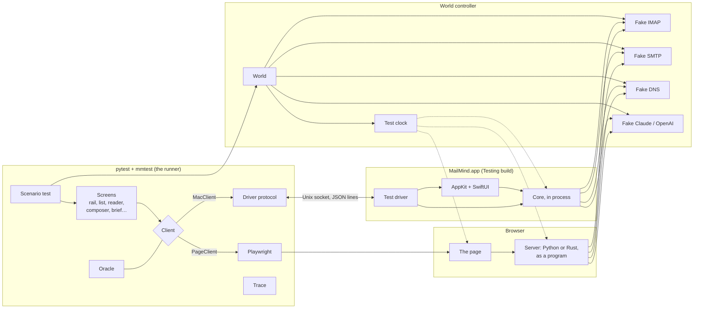
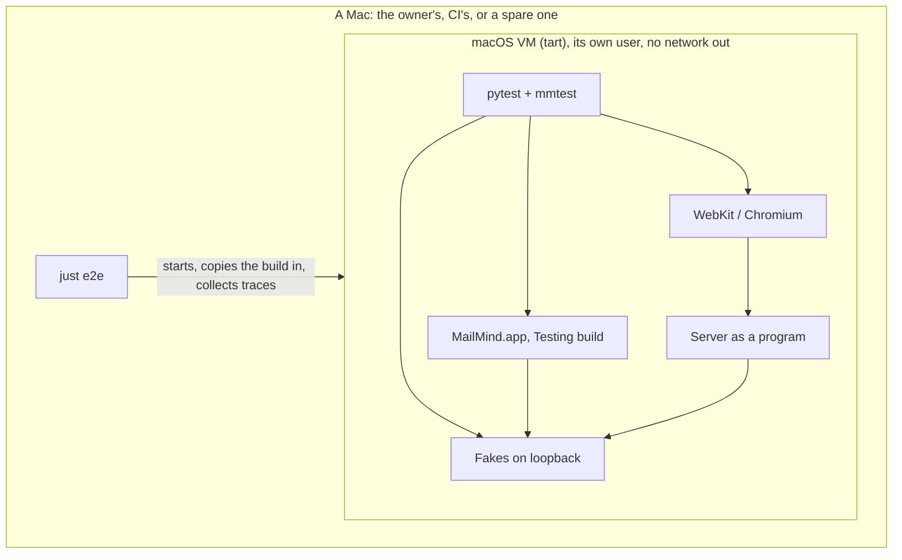

# The end-to-end test framework

[test-strategy.md](test-strategy.md) says what to test and at which ring. This document is the framework that runs
the whole-app rings (R3 to R5): its parts, how they connect, the protocol between them, and what a test looks like.
Lower rings keep the tools they have (`cargo test`, pytest's unit and served suites, XCTest, Vitest).

## 1. The shape

One test, written once in Python, drives either client: the Mac app or the page. It runs against a fictional world of
fake servers, it acts the way a person does, and after every step the framework checks that what the app shows agrees
with what the server holds.



The parts:

| Part | What it is | Where it lives |
| --- | --- | --- |
| `mmtest` | The framework: a pytest plugin with the world, the clients, the screens, the oracle and the trace | `tests/framework/mmtest/` |
| Scenarios | The tests, grouped by feature | `tests/scenarios/<feature>/test_*.py` |
| World controller | The fake servers, the corpus, delivery, faults and the clock, behind one object | `tests/framework/mmtest/world.py`, over `tests/fakes/` |
| Mac test driver | A module compiled only into the Testing build that carries out the runner's commands inside the app | `shells/apple/Sources/TestDriver/` |
| `MailMindTestKit` | Swift: real input (keys under a layout, mouse, menus), element lookup and settling. The driver and the hosted XCTest target both use it | `shells/apple/TestKit/` |
| Page client | Playwright on the real build, served by either server | `tests/framework/mmtest/page.py` |
| Element names | One vocabulary of names for what a person can see and act on, given to both clients | `tests/framework/names.toml` |

## 2. A test

```python
from mmtest import clients, mail

@clients("mac", "page")
def test_reply_all_to_many_keeps_the_words_above_the_signature(world, app):
    world.account("ada").signature = "Ada at the Guild"
    note = world.deliver(mail.from_("lin").to(6).cc(4).subject("Venue"))

    app.open("inbox")
    app.list.row(subject="Venue").open()
    composer = app.reader.reply_all()
    composer.type("Got it, thanks.")

    assert composer.send_button.visible
    composer.send()
    app.wait_for(world.smtp.received(1))

    sent = world.smtp.last()
    assert sent.text.startswith("Got it, thanks.\n\n-- \nAda at the Guild")
    assert sent.recipients == note.reply_all_recipients(me="ada")
```

What the test doesn't say is what the framework does around each line:

- `@clients("mac", "page")` runs the test twice, once on each client. A test that holds only one says so and why
  (`@clients("mac", reason="the page has no own windows")`).
- `world` is a fresh fictional world for each run: three accounts, the `tiny` corpus, every fake on loopback, and the
  clock frozen at the world's noon.
- Each action (`open`, `type`, `send`) goes through the client as real input, then **settles** (section 5), then runs
  the **oracle** (section 6). A failed invariant fails the test at the step that broke it, not at the end.
- `app.wait_for(...)` waits for a condition, never for time.
- A failure keeps a **trace** (section 7): every step, every request the fakes saw, every event the core published, a
  picture and the accessibility tree at each step.

## 3. The world controller

`World` is the one object a test talks to for everything outside the app. It is built on today's fakes and fixtures,
which already run under the tripwire.

```python
class World:
    accounts: dict[str, Account]          # ada (IMAP), bea (Proton Bridge), cy (Gmail)
    imap: FakeIMAP; smtp: FakeSMTP; dns: FakeDNS; ai: FakeAI
    clock: TestClock

    def deliver(self, message, to="ada", folder="INBOX") -> Delivered
    def corpus(self, name: str)           # tiny | daily | large | huge | a named shape
    def fault(self, script: Fault)        # imap.down(), imap.drop_after("UID MOVE"), smtp.refuse(), ai.slow(12)...
    def restart_app(self)                 # the same home, a new process
```

- **One clock.** `TestClock` is the time for the world, the server and the client. The server reads it through the
  core's `Clock` seam (the served protocol's `clock` line today; the driver's `clock` command for the Mac's
  in-process core). The page reads it through Playwright's `page.clock`. The Mac's Swift code reads it through one
  `AppClock`, which the Testing build lets the driver set. A test moves time with `world.clock.advance(hours=7)` or
  `world.clock.set("23:59", zone="Pacific/Auckland")`.
- **Faults are scripts.** A fault names what fails, when and how: on a command, after N bytes, for a duration of test
  time. Deterministic tests script them; the chaos ring draws them at random from the same vocabulary.
- **Corpora are generated.** `mail.from_(...).to(6).cc(4)` builds a message; named corpora (`daily`, `large`) are made by
  one generator, in Rust once `mm-world` exists, so both servers start from the same bytes.

## 4. The clients

Both clients implement one interface. A screen object calls only this interface, so a scenario never knows which client
it drives.

```python
class Client(Protocol):
    # input, as a person gives it
    def press(self, keys: str, layout: str = "us") -> None   # "e", "cmd+shift+f", "pagedown"
    def type(self, text: str) -> None
    def click(self, target: Element, button="left", count=1) -> None
    def drag(self, source: Element, onto: Element) -> None
    def choose_menu(self, *path: str) -> None                 # ("Message", "Archive")
    # looking
    def find(self, name: str, **where) -> Element            # by element name, filtered by text, row key…
    def shown(self) -> Shown                                  # what the person sees, in one shape (section 6)
    def picture(self) -> bytes
    # time and quiet
    def settle(self) -> None
    def truth(self) -> Truth                                  # what the server holds (section 6)
```

### 4.1 The Mac client and its driver

The Mac app's **Testing** build configuration compiles `Sources/TestDriver/` with the `TESTING` flag. Release and Debug
builds never contain it, and `release-check` fails if the driver's symbols are in the shipped app.

When `MAILMIND_TEST_DRIVER` names a socket path in the run's home, the driver listens there. The runner speaks JSON
lines to it:

```json
{"id": 7, "do": "press", "keys": "e", "layout": "us"}
{"id": 7, "ok": true}
{"id": 8, "do": "find", "name": "list.row", "where": {"subject": "Venue"}}
{"id": 8, "ok": true, "element": {"ref": "ax:41", "frame": [0, 212, 640, 52], "visible": true}}
```

| Command | What the driver does |
| --- | --- |
| `press`, `type` | Builds a `CGEvent` from a key code under the named layout and posts it to its own process, so AppKit routes it: menus first, then the key window's responder chain |
| `click`, `drag`, `scroll` | Posts real mouse events at the element's frame |
| `menu` | Finds the item in the real menu bar, validates it as AppKit would, and performs it; it fails if the item is disabled |
| `find`, `ax` | Walks the app's own accessibility tree by element name |
| `shown` | Builds the `Shown` snapshot from the accessibility tree (section 6) |
| `picture` | Draws a window through the window server |
| `settle` | Answers once the app is quiet (section 5) |
| `core` | Passes `clock`, `work`, `settle`, `check` and route reads to the in-process core, as the served protocol does for a server |

The driver is built on `MailMindTestKit`, which the hosted XCTest target (R3) uses too, so the in-process tests and the
launched-app tests send input the same way.

**It needs a real session.** The app must be able to become active, its screen must be unlocked, and WebKit must draw.
The runs happen in a macOS VM (section 8), never on a person's session. No swizzling, forced key windows or private
selectors: what the review's probe needed those for, the VM gives for free.

### 4.2 The page client

`PageClient` wraps Playwright on the real build, served by the Python or the Rust server through today's served
protocol. It runs in WebKit and Chromium. `find` maps an element name to `page.get_by_test_id(name)` (Playwright's test
id attribute set to `data-mm`), `shown` reads the same snapshot from the DOM, and `settle` waits for the network and a
quiet animation frame.

### 4.3 Element names

A screen object finds things by name, and each client carries the names:

- On the Mac, as `accessibilityIdentifier`.
- On the page, as `data-mm`.

Names read `area.element`, with a part after a colon where there are several: `rail.place:inbox`, `list.tab:needs`,
`list.row`, `reader.verb:archive`, `composer.field:cc`, `composer.send`, `toast`, `empty.title`. The vocabulary is one
file, `tests/framework/names.toml`. A check on each side (an ESLint rule for the page, a Swift test walking the app's
views for the Mac) fails on a name that isn't in it, and the runner fails on a name a screen uses that a client
doesn't carry.

Today the Mac sets one identifier and the page none; the browser tests find elements by CSS about 1,250 times. Adding
names is mechanical work, done area by area as each area's scenarios are written.

### 4.4 Screens

A screen is a class per area of the app, written once against `Client`:

```python
class List(Screen):
    def tab(self, which: str) -> Tab: ...            # "needs", "everything", "unread"
    def row(self, *, subject=None, key=None) -> Row: ...
    def chosen(self) -> Row | None: ...

class Row(Element):
    def open(self): self.client.click(self)          # choosing a row opens it in the reader
    def archive(self): self.open(); self.app.press("e")
```

Screens are the only place that knows how a person does a thing. When both clients do it differently (a double-click
in a Mac window, a click on the page), the screen says so once.

## 5. Settling

A step ends when the app is quiet, never after a fixed time. Quiet means all of:

| Part | Quiet when |
| --- | --- |
| The world | No fake has a command in flight; deliveries are stored |
| The server or core | Its `settle` answers: no request in flight, no job running that a request started |
| The Mac app | No `RouteCaller`, `Wire` or `Routes` request in flight; the main run loop has turned twice with nothing queued; no window is mid-animation (the Testing build sets animations to zero length) |
| The page | No request in flight; two animation frames with no DOM change |

`settle` has a long ceiling (30 s, as `wait_until` has), and reaching it fails the step with what was still busy.

## 6. The oracle

After every step, the runner takes two readings and checks them against each other.

- **`Shown`** is what the person sees, read from the accessibility tree or the DOM by element name, never from the app's
  models: the place and scope, each count on screen (the rail's badge, the tab's, the brief's tally), the rows in
  view with their key, subject and marks, the row chosen, the message open, where the keyboard is, any toast,
  empty-state sentence or sheet, and each open window.
- **`Truth`** is what the server holds, read through its routes: the digest, the list of the place shown, the message,
  the outbox, the drafts.

The invariants are functions over the two readings and the step history:

```python
@invariant
def counts_agree(shown, truth):
    for place, badge in shown.counts.items():
        expect(badge == truth.count(place), f"{place} shows {badge}, the server says {truth.count(place)}")

@invariant
def the_keyboard_is_somewhere(shown):
    expect(shown.focus is not None and shown.focus.visible, "no visible element has the keyboard")

@invariant
def typed_words_are_kept(shown, truth, history):
    for words in history.typed:
        expect(words in shown.composers or words in truth.drafts or words in truth.sent, f"{words!r} is nowhere")
```

The first set:

- Counts agree across the rail, the tabs, the brief and the server.
- The chosen row is the open message, or the reader says where the open message lives.
- No surface shows a message the server has moved away, once its event has landed.
- No list shows a `pending_removal` row.
- The keyboard is on a visible element a person can type into or act on.
- No sentence contradicts the state it describes ("Nothing needs you" over rows that need you).
- Typed words are in a composer, a draft or a sent message.
- No toast stays past its time.

An invariant can be relaxed for one step (`with app.expecting(counts_lag=True):`) when a test is about a lag on
purpose, never for a whole test.

## 7. The trace

Every step adds to a trace: the step's name and arguments, the time on the test clock, the requests each fake received,
the events the core published, `Shown` and `Truth`, a picture of each window, and the accessibility tree. A passing test
keeps nothing. A failing one writes the trace to `build/traces/<test>/`, with an HTML page that steps through it, and
CI uploads the folder.

## 8. Where it runs



Everything runs inside the VM: the runner, the fakes, the app and the browsers. The host only starts it, copies the
build in and takes the traces out. Locally `just e2e` does that; CI's merge tier runs the same image on a macOS runner.
The page's scenarios can also run without a VM (`just e2e --page`), on Linux in CI, since a browser needs no session of
its own.

Inside the VM the app can be active, the screen is never locked, WebKit draws, drag and drop and notifications are
real, and each run picks its keyboard layout. No test can reach the host's data, its Keychain or its running MailMind.

## 9. The rings on this framework

| Ring | Uses |
| --- | --- |
| R3, the Mac in process | `MailMindTestKit` in a hosted XCTest target, inside the VM |
| R3, the page | Playwright on the real build (today's browser suite), moving to `data-mm` names |
| R4, scripted | Scenarios through both clients, the oracle after every step |
| R5, model-based | A Hypothesis `RuleBasedStateMachine` whose rules are screen actions, run against either client, with the oracle as its invariant |
| R5, chaos | Scenarios with faults drawn at random from the world's fault vocabulary |
| R5, soak | One long scenario delivering mail for hours, with the driver sampling memory, handles and threads |
| R6, release | The scenario catalogue on a Testing build of the release commit, built with the Release configuration's settings and only the driver added; the upgrade matrix; the update from the previous release |

## 10. Building it

1. **The skeleton.** `mmtest` with `World` over today's fakes, `PageClient` over today's browser fixtures, settle and
   trace, and three scenarios ported from the browser suite. The page needs no new names to start: its first screens
   use roles.
2. **The Mac driver and test kit.** The Testing configuration, `MailMindTestKit` from `Tests/RealKeys.swift` and
   `MailFrameTests.press`, the socket, `press`, `click`, `menu`, `find`, `settle`, and the core passthrough. The
   `AppClock` seam in Swift.
3. **The VM.** One `tart` image with Xcode's runtime, Python and the browsers; `just e2e`.
4. **Names and screens, area by area.** Start with the areas the review found most in: the list and triage, the
   composer, the reader, windows and menus. For each area, add the names to both clients, write its screen, and port
   the review's findings into scenarios.
5. **The oracle.** The first set of invariants, run after every step, with relaxations named.
6. **Model-based and chaos runs.** The state machine over screens; faults at random; the soak.

**Decisions this takes.** It answers the open questions in [test-strategy.md](test-strategy.md) section 10:

- A VM rather than a spare logged-in Mac, because it is the same image locally and in CI.
- An in-app driver rather than XCUITest, because XCUITest can't read the app's state for the oracle, needs the app
  active from outside, and is slow. A handful of XCUITest runs in the VM can check that real activation still works.
- Scenarios in Python on pytest rather than YAML, because the fakes, the fixtures and the served protocol are already
  Python and pytest, and a test can then use loops, helpers and Hypothesis.

The fourth decision, whether a missed wall-time budget blocks a release, stays with the owner.
